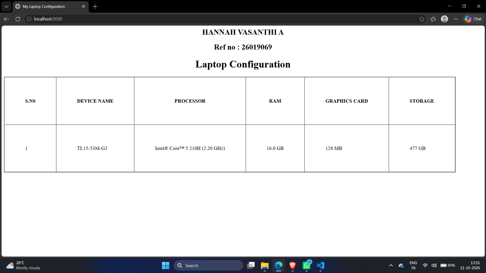
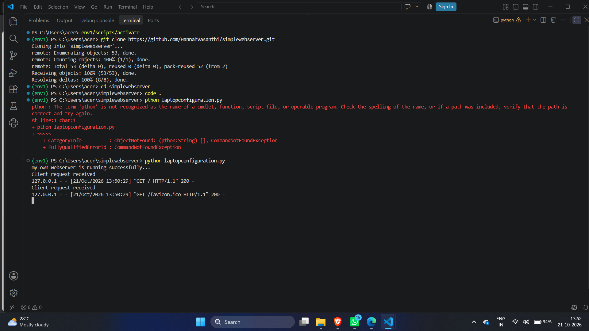

# EX01 Developing a Simple Webserver
## Date:
30/09/2026

## AIM:
To develop a simple webserver to serve html pages and display the Windows Specifications of your Laptop.

## DESIGN STEPS:
### Step 1: 
HTML content creation.

### Step 2:
Design of webserver workflow.

### Step 3:
Implementation using Python code.

### Step 4:
Import the necessary modules.

### Step 5:
Define a custom request handler.

### Step 6:
Start an HTTP server on a specific port.

### Step 7:
Run the Python script to serve web pages.

### Step 8:
Serve the HTML pages.

### Step 9:
Start the server script and check for errors.

### Step 10:
Open a browser and navigate to http://127.0.0.1:8000 (or the assigned port).

## PROGRAM:
```
from http.server import HTTPServer, BaseHTTPRequestHandler
content = """
<html>
<head>
        <title> My Laptop Configuration</title>
    
    </head>
    <body>
        <h2 align="center"> HANNAH VASANTHI A</h2>
        <h2 align="center">Ref no : 26019069</h2>
        <h1 align="center">Laptop Configuration</h1>
        <table border="2" cellspacing="0" cellpadding="65">
            
            <tr>
                <th>S.N0</th>
                <th>DEVICE NAME</th>
                <th>PROCESSOR</th>
                <th>RAM</th>
                <th>GRAPHICS CARD</th>
                <th>STORAGE</th>
            </tr>
            <tr>
                <td>1</td>
                <td>TL15-53M-G2</td>
                <td>Intel&reg; Core&trade; 5 210H (2.20 GHz)</td>
                <td>16.0 GB</td>
                <td>128 MB</td>
                <td>477 GB</td>
            </tr>

        </table>
    
    </body>

        
</html>
"""
class myhandler(BaseHTTPRequestHandler):
    def do_GET(self):
        print("Client request received")
        self.send_response(200)
        self.send_header('content-type', 'text/html; charset=utf-8')
        self.end_headers()
        self.wfile.write(content.encode())
server_address = ('',8000)
httpd = HTTPServer(server_address,myhandler)
print("my own webserver is running successfully...")
httpd.serve_forever()

```


## OUTPUT:
webpage


webserver


## RESULT:
The program for implementing simple webserver is executed successfully.
